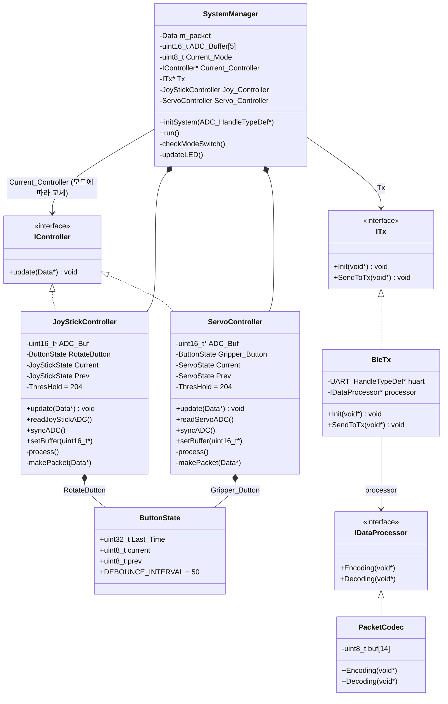
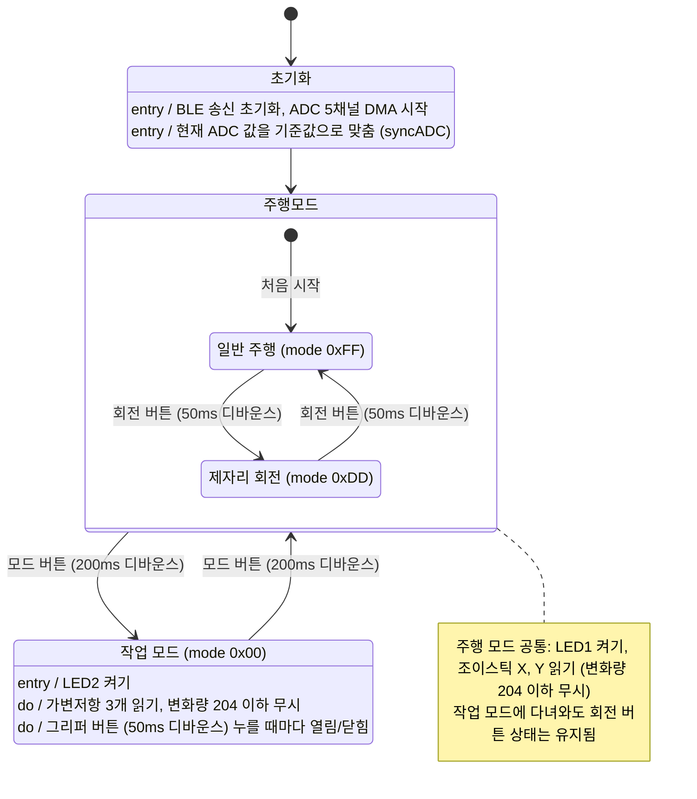

# LIGNex1 RC Robot Controller

  
  

LIG D&A The SSEN 임베디드SW 스쿨에서 진행한 팀 프로젝트입니다. (2026.01 ~ 2026.03, 팀 5인)

STM32와 FreeRTOS를 기반으로 UGV의 주행과 로봇 팔을 제어하는 RC Robot Controller를 개발했습니다.
Controller에서 조이스틱과 가변저항 입력을 처리하고, Bluetooth(BLE)로 UGV에 제어 데이터를 보내
하나의 조종부로 주행, 제자리 회전, 로봇 팔 작업을 조작할 수 있게 구성했습니다.

## 담당 역할

5인 중 **Controller** 담당
- 조작부 하드웨어 구성
- ADC 입력 처리 (5채널 DMA 수집, 작은 변화 무시)
- 모드 전환 구조 설계 (모드별 Controller 분리)

## Features

- 조이스틱으로 UGV 주행, 회전 버튼으로 제자리 회전
- 가변저항 3개와 그리퍼 버튼으로 로봇 팔 제어
- 모드 버튼으로 주행 / 작업 모드 전환, LED로 현재 모드 표시
- 변화량이 ADC 범위(12-bit)의 5%(204) 이하인 흔들림은 제어값에 반영하지 않음
- 14바이트 패킷(체크섬 포함)으로 UGV에 제어 데이터 송신

## 구조

입력은 모드와 상관없이 항상 수집하고, 현재 모드의 Controller만 해석합니다.
모드가 바뀌면 `SystemManager`가 `Current_Controller`만 교체합니다.

## 모드 전환

## 통신 패킷 (14 bytes)

`PacketCodec::Encoding`에서 만들고, UART에 연결된 BLE 모듈로 송신합니다. 2바이트 값은 하위 바이트를 먼저 보냅니다.

| Byte | 내용 | 설명 |
|---|---|---|
| 0 | SOF | 시작 바이트 `0xAA` |
| 1 | mode | `0xFF` 주행, `0xDD` 제자리 회전, `0x00` 작업 |
| 2 | gripper | 그리퍼 열림/닫힘 (0 / 1) |
| 3-4 | motor_x | 조이스틱 X (ADC 0 ~ 4095) |
| 5-6 | motor_y | 조이스틱 Y (ADC 0 ~ 4095) |
| 7-8 | servo_top | 가변저항 1 (ADC 0 ~ 4095) |
| 9-10 | servo_mid | 가변저항 2 (ADC 0 ~ 4095) |
| 11-12 | servo_bot | 가변저항 3 (ADC 0 ~ 4095) |
| 13 | checksum | 0 ~ 12번 바이트의 XOR |

## Development Environment

- MCU: STM32F103RB (Cortex-M3)
- RTOS: FreeRTOS (CMSIS-RTOS v2)
- Language: C++ (애플리케이션), C (HAL, FreeRTOS)
- Tools: STM32CubeMX, VS Code, CMake

## Team Repository

본 저장소는 팀 프로젝트 당시 소스 코드를 개인 포트폴리오용으로 정리한 저장소입니다.

Original Team Repository: https://github.com/MainForm/LIGNex1_RC_Robot_Controller/tree/feature/controller_ble_merge_test
